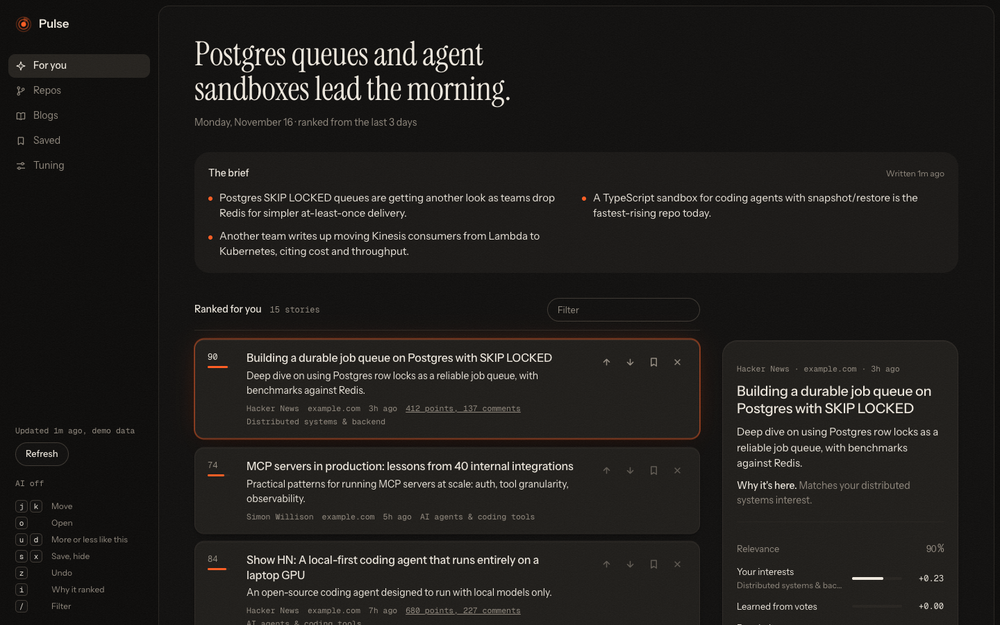

# Pulse

A news feed that runs on your own machine. It collects AI and developer news, company engineering blogs and trending GitHub repos, ranks them for you, and gets better the more you vote.

<!-- Screenshot: add one at docs/screenshot.png and uncomment the next line. -->
<!--  -->

- **One place to read.** Hacker News, AI news sites, 22 company engineering blogs and GitHub Trending, all in one keyboard-driven page.
- **Ranked for you.** It starts with the topics you set and learns from every upvote, downvote, save and click.
- **AI is optional.** Connect a local model (Ollama) or an API key to get one-line summaries, a "why this matters to you" line and a short morning brief. Without one, ranking still works.
- **Nothing to host.** One Node process and one SQLite file. No Docker, no account, nothing leaves your machine except the feed requests (and LLM calls, if you use a hosted model).

## Contents

- [Quick start](#quick-start)
- [Setup in detail](#setup-in-detail)
- [Using Pulse](#using-pulse)
- [Sources](#sources)
- [Configuration](#configuration)
- [How ranking works](#how-ranking-works)
- [API](#api)
- [Troubleshooting](#troubleshooting)
- [Project layout](#project-layout)
- [Contributing](#contributing)
- [License](#license)

## Quick start

You need **Node.js 22.13 or newer** (`node -v`). Pulse uses Node's built-in SQLite, so there is nothing else to install.

```bash
git clone https://github.com/tjena007/pulse.git
cd pulse
npm install
npm run demo
```

Open http://localhost:4321. Demo mode uses made-up stories and needs no network or AI, so you can see the interface first.

When you're ready for real data:

```bash
cp .env.example .env
npm start
```

Then press **Refresh** in the sidebar. The first refresh takes a minute or two, longer with a local model. After that Pulse refreshes on its own every 30 minutes, and the sidebar shows roughly how long a running refresh has left.

## Setup in detail

### 1. Choose an AI provider (optional)

Set `LLM_PROVIDER` in `.env` to one of these:

| Provider | Value | What you need |
| --- | --- | --- |
| None | `none` | Nothing. Ranking works; no summaries or brief. |
| Ollama (local, free) | `ollama` | Ollama running with a model pulled. |
| Anthropic | `anthropic` | `ANTHROPIC_API_KEY`. The default model is `claude-haiku-5-5`. |
| OpenAI or compatible | `openai` | `OPENAI_API_KEY` and `OPENAI_MODEL`. Set `OPENAI_BASE_URL` for LM Studio, vLLM, OpenRouter and similar. |

Only the top candidates of each refresh are sent to the model (40 by default, set with `LLM_ENRICH_LIMIT`), so hosted models stay cheap.

### 2. Ollama, if you want everything local

```bash
brew install ollama        # or see https://ollama.com for Linux and Windows
ollama serve
ollama pull qwen3:8b       # any model works; set OLLAMA_MODEL to match
```

Small models are fine for scoring and one-line summaries. If summaries read poorly, try a larger model or a hosted provider.

### 3. GitHub token (optional)

A `GITHUB_TOKEN` with no scopes raises the GitHub Search rate limit, which the "new and rising repos" source uses. Pulse works without one.

### 4. Make it yours

Open the **Tuning** tab and edit your interest topics, keywords and weights, the short "about me" text the AI reads, and words to mute. Starting topics come from `config.json` and are copied into the database the first time you save; after that, Tuning is the place to change them.

### Running it in the background

`npm start` runs in the foreground. To keep it running, use any process manager, for example:

```bash
npx pm2 start npm --name pulse -- start
```

## Using Pulse

### Tabs

- **For you:** news from the last 3 days, ranked, with the AI brief on top.
- **Repos:** trending and fast-rising GitHub repos from the last 7 days.
- **Blogs:** posts from company engineering blogs over the last 60 days. These stay out of For You, so it remains a news feed.
- **Saved:** anything you saved, newest first.
- **Tuning:** your interests, muted words, what Pulse has learned from your votes, and which sources failed on the last refresh.

### Keyboard

| Key | Action |
| --- | --- |
| `j` / `k` | Move down / up |
| `o` or `Enter` | Open the selected item |
| `u` | More like this (press again to undo) |
| `d` | Less like this, and hide it |
| `s` | Save or unsave |
| `x` | Hide |
| `z` | Undo the last hide or "less like this" |
| `i` | Show why the selected item ranked where it did |
| `/` | Filter the current tab |

The orange bar on each row shows how relevant it is to you. Hover it, or press `i`, for the breakdown.

### Look and motion

Pulse uses a dark theme by default. A light palette is included and turns on with `data-theme="light"` on the `<html>` element. Animations are skipped when your system has "reduce motion" turned on.

## Sources

| Group | Sources |
| --- | --- |
| News | Hacker News (60+ points), Simon Willison, Latent Space, The Verge AI, TechCrunch AI, Lobsters, r/LocalLLaMA, arXiv cs.AI (off by default) |
| Engineering blogs | Netflix, Meta, Google Research, AWS Architecture, Apple ML, Airbnb, Spotify, Cloudflare, Stripe, GitHub, Discord, Shopify, Dropbox, Figma, Vercel, Pinterest, Lyft, Datadog, Databricks, OpenAI, Google DeepMind, Hugging Face |
| Repos | GitHub Trending (all languages, TypeScript, Python, Go, Rust) and new repos already gaining stars |

### Adding your own feed

Add an entry to `sources.rss` in `config.json` and restart:

```json
{ "name": "My favourite blog", "url": "https://example.com/feed.xml", "enabled": true }
```

Add `"kind": "blog"` to send it to the Blogs tab instead of For You. RSS, Atom and RDF feeds all work. Set `"enabled": false` to switch a feed off without deleting it.

## Configuration

**`config.json`** holds the sources, the starting interests and muted words, and `retentionDays` (how long news is kept; blog posts are always kept for 60 days).

**`.env`** holds runtime settings:

| Variable | Default | Meaning |
| --- | --- | --- |
| `PORT` | `4321` | Port to serve on |
| `HOST` | `127.0.0.1` | `0.0.0.0` makes it reachable from other devices on your network |
| `REFRESH_MINUTES` | `30` | How often to refresh |
| `LLM_PROVIDER` | `ollama` | `none`, `ollama`, `anthropic` or `openai` |
| `LLM_ENRICH_LIMIT` | `40` | How many items get AI summaries per refresh |
| `GITHUB_TOKEN` | none | Optional, raises the GitHub rate limit |

Plus the provider-specific keys, models and URLs listed in `.env.example`.

Pulse has no login. If you set `HOST=0.0.0.0`, keep it behind something like Tailscale rather than exposing it to the internet.

Your data (items, votes, learned weights, settings) lives in `data/pulse.db`. Delete that file to start over.

## How ranking works

```
base  = 0.38·interest + 0.18·popularity + 0.14·learned + 0.30·ai     (with an AI provider)
      = 0.50·interest + 0.30·popularity + 0.20·learned               (without)
score = base × (0.35 + 0.65·freshness)
```

Freshness halves every 24 hours for news, 48 hours for repos and 14 days for blog posts.

- **interest:** keyword hits for each of your topics (a hit in the title counts double), times the topic's weight.
- **learned:** a small model over title words, word pairs, tags, source and repo language. Each vote nudges those weights, and undoing a vote reverses it.
- **popularity:** Hacker News points or GitHub stars per day, on a log scale. Pulse saves star counts daily, so repos also get a star-history sparkline after a few days.
- **ai:** the model's 0 to 10 relevance score, when an AI provider is set.

After scoring, a diversity pass stops one source from filling the top of a list, and muted words push items to the bottom.

## API

Everything the interface does goes through JSON endpoints, so other local tools can use them too.

| Method | Path | What it does |
| --- | --- | --- |
| `GET` | `/api/feed?tab=foryou\|repos\|blogs\|saved&q=&limit=` | Ranked items for a tab |
| `GET` | `/api/digest` | Brief, top 10 stories and top 8 repos in a compact form, for dashboards |
| `GET` | `/api/brief` | The latest AI brief |
| `POST` | `/api/feedback` | `{ id, action }` where action is `up`, `down`, `clear`, `save`, `unsave`, `hide`, `unhide` or `open` |
| `POST` | `/api/refresh` | Start a refresh. `{ reenrich: true }` also redoes AI summaries |
| `GET` | `/api/status` | Refresh progress, time left, source health and AI settings |
| `GET` / `PUT` | `/api/profile` | Interests, muted words and the "about me" text |
| `GET` / `DELETE` | `/api/learned` | What Pulse has learned from votes, or reset it |

## Troubleshooting

- **A source shows as failed in Tuning.** Run `npm run refresh` for a table of every source and its error. Some sites (Reddit, for example) block scripts from time to time; a failed feed never breaks the others.
- **No summaries or brief.** Check the AI line at the bottom of the sidebar. For Ollama, make sure `ollama serve` is running and `OLLAMA_MODEL` matches a model you've pulled. For hosted providers, check the API key in `.env`.
- **`node:sqlite` errors on start.** Your Node is too old. Install 22.13 or newer.
- **Port already in use.** Set a different `PORT` in `.env`.
- **Demo posts mixed into the real feed.** Demo mode writes to the same database. Delete `data/pulse.db` to start clean, or just let them age out.
- **GitHub Trending is empty.** It has no official API and is read from the web page, so a GitHub redesign can break it. The new-repos source keeps working.

## Project layout

```
src/
  server.ts        HTTP routes and the refresh timer
  refresh.ts       fetch → store → rank → AI summaries → brief, plus progress and time left
  rank.ts          scoring and learning from votes
  llm.ts           Ollama, Anthropic and OpenAI adapters and prompts
  db.ts            SQLite schema and queries (node:sqlite)
  sources/         hackernews.ts, rss.ts, github.ts
  fixtures.ts      demo data
  cli-refresh.ts   `npm run refresh`
public/            index.html, app.js, styles.css (no build step)
config.json        sources and starting interests
```

## Contributing

Issues and pull requests are welcome. Before opening a PR, run:

```bash
npm run typecheck
```

There is no build step: the server runs TypeScript directly through `tsx`, and the frontend is plain HTML, CSS and JavaScript. `npm run dev` restarts the server when you change a file.

## License

[MIT](LICENSE)
